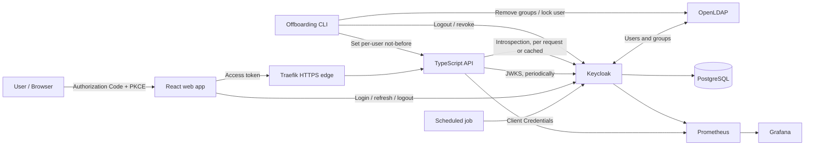

# IAM Access Revocation Lab

An explainable, reproducible Identity and Access Management laboratory for measuring what happens to API access when an employee is offboarded.

The project combines OAuth 2.0, OpenID Connect, LDAP federation, fine-grained API authorization, token introspection, revocation, and observability. Its central question is measurable:

> After access is removed, how long can an already-issued credential still reach an API?

> [!IMPORTANT]
> The complete lab is executable: identity, three API token-validation modes, browser security console, scheduled workload, offboarding experiments, Prometheus collection, and a provisioned Grafana presentation dashboard.

## What this project demonstrates

- Authorization Code with PKCE for a browser application
- Client Credentials for a scheduled service
- Keycloak federation with OpenLDAP users and groups
- Scope-, role-, and resource-owner-based authorization
- Local JWT validation using JWKS
- RFC 7662 token introspection, with and without a short cache
- Refresh-token rotation and RFC 7009 revocation
- Automated employee offboarding with measured revocation delays
- Prometheus and Grafana visibility into latency and identity-provider calls
- A repeatable test matrix producing 200, 401, and 403 evidence

## Architecture at a glance



The API runs the same authorization policy in three validation modes:

| Mode | Token check | Keycloak dependency | Expected revocation window |
|---|---|---:|---|
| Local | Signature and claims via cached JWKS | Only for key rotation | Until token expiry, unless per-user not-before rejects it |
| Introspection | RFC 7662 on every request | Every authenticated request | Near-immediate after Keycloak invalidates the token |
| Cached introspection | RFC 7662 result cached briefly | Once per cache entry | Approximately the cache TTL |

See [the complete architecture](docs/architecture.md) and [authorization model](docs/authorization-model.md).

## Authorization model

Access is granted only when all applicable layers pass:

1. **Client scope** — what the calling application may request.
2. **LDAP-derived realm role** — what the person is allowed to do.
3. **Resource ownership** — which records that person may access.

Authentication failures return **401 Unauthorized**. An authenticated caller that lacks scope, role, service-account identity, or ownership receives **403 Forbidden**.

## Repository structure

```text
.
├── docs/                 Architecture, authorization, ADRs, and demonstration guide
├── infra/                Executable LDAP, Keycloak, and Traefik configuration
├── services/             API, web application, scheduled job, and offboarding service
├── scripts/              Secret, certificate, and readiness helpers
├── tests/                Matrix, offboarding, benchmark, and plotting tools
├── results/              Reproducible CSV results and generated charts
├── report/               Technical report and exported figures
├── docker-compose.yml    Stable service topology
└── Makefile              Canonical commands and safety gates
```

Each major area contains a focused README with its operational contract.

## Developer workflow

Identity, API, console, and workload commands available now:

```bash
make help
make secrets
make certs
make config
make check
make images
make supply-chain
make up
make ldap-test
make identity-test
make api-test
make web-test
make browser-test
make job-test
make observability-test
make test
make matrix-evidence
make offboard USER=marwa
make restore USER=marwa
make bench
make export
make logs
make down
```

`make images` builds the three project-owned runtime images. `make supply-chain` scans complete Git history, dependency manifests, and those images using digest-pinned Gitleaks and Trivy containers. `make up` initializes or reuses persistent LDAP, PostgreSQL, Redis, Prometheus, and Grafana volumes; verifies the versioned `company` realm; starts one API image in all three modes; runs the scheduled job; and exposes the lab surfaces over HTTPS. `make identity-test` proves the issuer, LDAP-derived claims, and client credentials. `make api-test` proves authorization parity and revocation behavior. `make web-test` proves the console build, HTTPS security headers, valid browser scopes, S256 discovery, and exact-origin CORS. `make browser-test` uses an installed Chrome and trusted `mkcert` CA to exercise PKCE login, callback, API access, real silent refresh and rotation, reload behavior, revocation, and logout. `make job-test` proves bounded token reuse, successful report calls, non-root execution, and secret-safe logs. `make observability-test` proves private Prometheus scraping, bounded non-secret metrics, healthy targets, and automatic Grafana provisioning. `make test` includes the external authorization matrix and observability proof but writes nondeterministic samples only under ignored `results/raw/`; `make matrix-evidence` explicitly replaces the canonical matrix after all rows pass. `make down` stops containers without deleting data. `make reset CONFIRM=reset` deletes local volumes and must be used only after explicit operator approval.

API entry points are `https://api.localhost/local`, `https://api.localhost/introspection`, and `https://api.localhost/cached`. Each prefix exposes `/health`, `/openapi.json`, `/docs`, `/me`, `/documents`, `/admin/users`, `/reports/run`, and `/metrics` as applicable. The revocation mutation endpoint is internal-only and is never routed by Traefik.

The security console is at `https://app.localhost`. It uses Authorization Code with PKCE S256, keeps processed tokens only in memory, distinguishes ID-token claims from access-token claims, and provides the live mode matrix, document policy view, administrator gate, and an explicitly non-live preview of the offboarding workflow.

The presentation dashboard is at [https://grafana.localhost/d/iam-access-revocation/access-horizon](https://grafana.localhost/d/iam-access-revocation/access-horizon). Anonymous access is viewer-only; the generated administrator password remains in the ignored `.env`. Prometheus has no host port and is reachable only on the private observability network.

The evidence workflow is:

```bash
make test
make matrix-evidence
make offboard USER=marwa
make measure
make bench
make export
```

`make offboard` performs the complete automated workflow immediately for the designated lab subject, Marwa; it intentionally leaves her offboarded so the refusal can be demonstrated. `make restore USER=marwa` restores the declared employee baseline afterward. Both commands refuse other usernames so the lab cannot accidentally preserve or restore the wrong role set. `make measure` is the long experiment: it runs baseline and automated offboarding for 60-, 300-, and 900-second access tokens, three repetitions each. It changes and restores Marwa and the realm token lifespan, so the runner refuses the default Compose project. Use one isolated name consistently:

```bash
COMPOSE_PROJECT_NAME=iam-m6-evidence make up
COMPOSE_PROJECT_NAME=iam-m6-evidence make measure
COMPOSE_PROJECT_NAME=iam-m6-evidence make bench
COMPOSE_PROJECT_NAME=iam-m6-evidence make down
```

Raw receipts remain ignored under `results/raw/`; canonical CSV is replaced only when a run is complete. `make export` refuses incomplete evidence before regenerating charts. No command above deletes the experiment volumes.

The final clean-clone acceptance path is:

```bash
git clone https://github.com/aya-fdhila/iam-access-revocation-lab.git
cd iam-access-revocation-lab
cp .env.example .env
npm --prefix services/api ci
npm --prefix services/webapp ci
npm --prefix services/job ci
make secrets
make certs
make check
make supply-chain
make up
make ldap-test
make identity-test
make test
```

No secrets or generated local certificates are committed. GitHub Actions repeats the quality, supply-chain, and complete clean-clone runtime proof on pull requests and `main`. See the [CI and supply-chain contract](docs/ci.md) and [local development contract](docs/development.md) for recovery and restart rules.

## Evidence produced

| Artifact | Purpose |
|---|---|
| `results/matrix.csv` | Expected and obtained status by profile, route, and validation mode |
| `results/offboarding.csv` | Failure delays from group removal and account lock |
| `results/bench.csv` | Throughput, latency, and Keycloak calls per request |
| `results/*.png` | Presentation-ready charts generated from the CSV evidence |
| `report/evidence-summary.json` | Deterministic CSV-to-report metric ledger with source, selection, calculation, value, and unit |

The experiment runs access-token lifetimes of 1, 5, and 15 minutes, three repetitions each, and records the first failure observed for new login, refresh, local validation, introspection, and cached introspection.

## Documentation

- [Architecture](docs/architecture.md)
- [Authorization model](docs/authorization-model.md)
- [Local development contract](docs/development.md)
- [CI and supply-chain checks](docs/ci.md)
- [Presentation demo script](docs/demo-script.md)
- [Technical report](report/report.md)
- [Report evidence ledger](report/evidence-summary.json)
- [Architecture decisions](docs/adr/README.md)

## Project principles

- Prefer readable, explainable implementation over cleverness.
- Pin image and package versions; never use `latest`.
- Keep tokens and secrets out of Git and browser persistent storage.
- Treat security behavior as something to prove with negative tests.
- Measure hypotheses instead of presenting them as results.
- Keep configuration reproducible from a clean clone with no admin-console clicks.

## Branch protection

The default branch is governed by the [`protect-main`](.github/rulesets/protect-main.json) ruleset. It cannot be deleted or force-pushed. No status check is required yet.

Create the ruleset once with:

```bash
gh api --method POST repos/aya-fdhila/iam-access-revocation-lab/rulesets \
  --input .github/rulesets/protect-main.json
```

To re-apply the file, find the existing ruleset ID and update it:

```bash
RULESET_ID="$(gh api repos/aya-fdhila/iam-access-revocation-lab/rulesets \
  --jq '.[] | select(.name == "protect-main") | .id')"
gh api --method PUT "repos/aya-fdhila/iam-access-revocation-lab/rulesets/${RULESET_ID}" \
  --input .github/rulesets/protect-main.json
```

After the CI workflow exists and its job has run at least once, add a `required_status_checks` rule using the exact CI job name.

## Project status

The complete lab includes the identity stack, three API validation modes, security console, scheduled workload, automated offboarding protocol, observability, reproducible evidence, and a technical report with quantified risk recommendations.

## License

No license has been selected yet. Until one is added, all rights are reserved by the repository owner.
