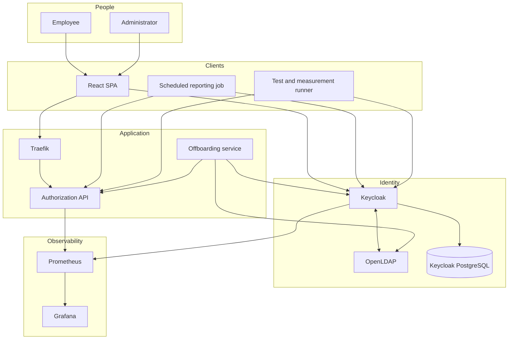
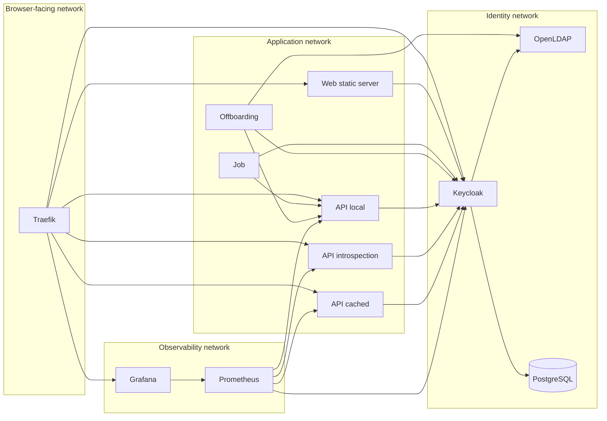
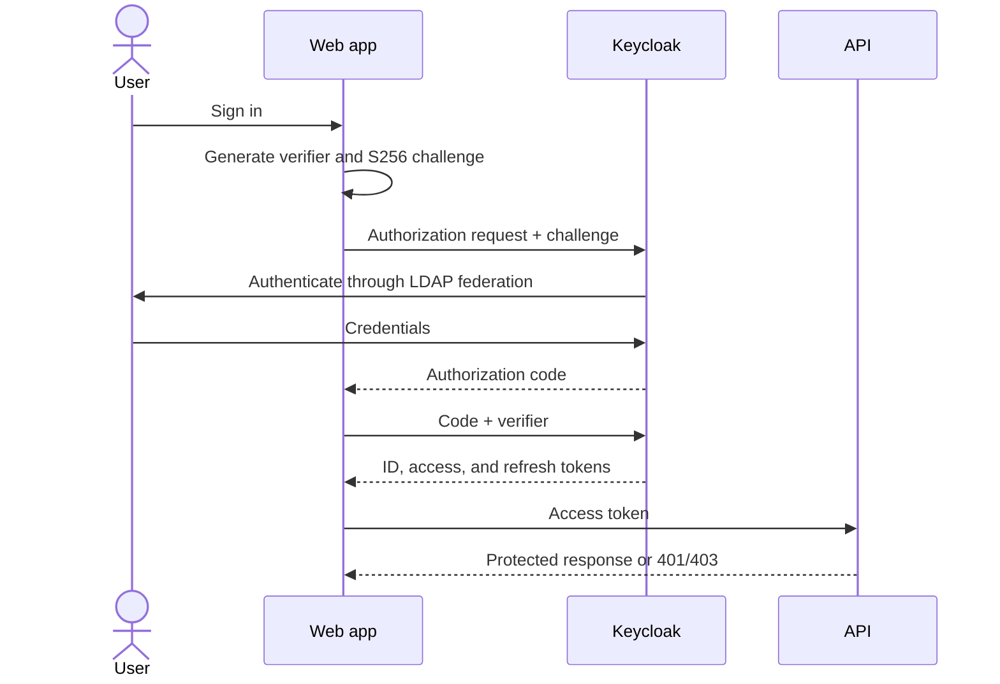
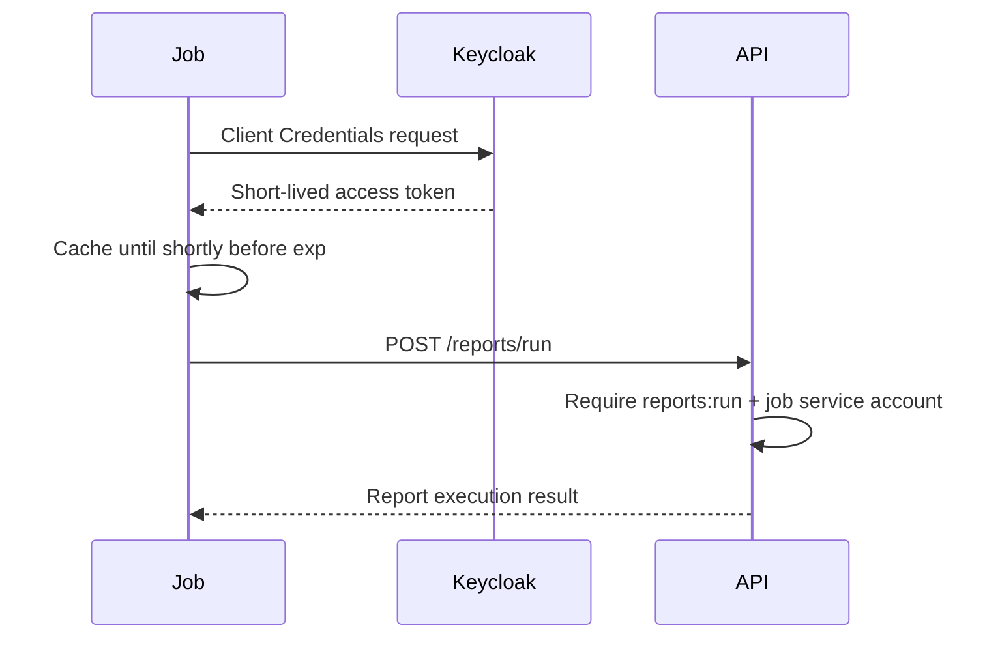
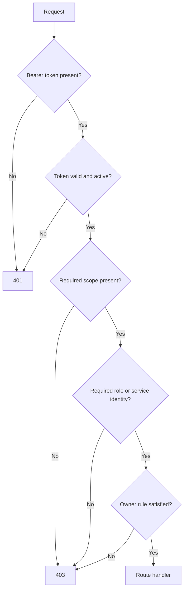
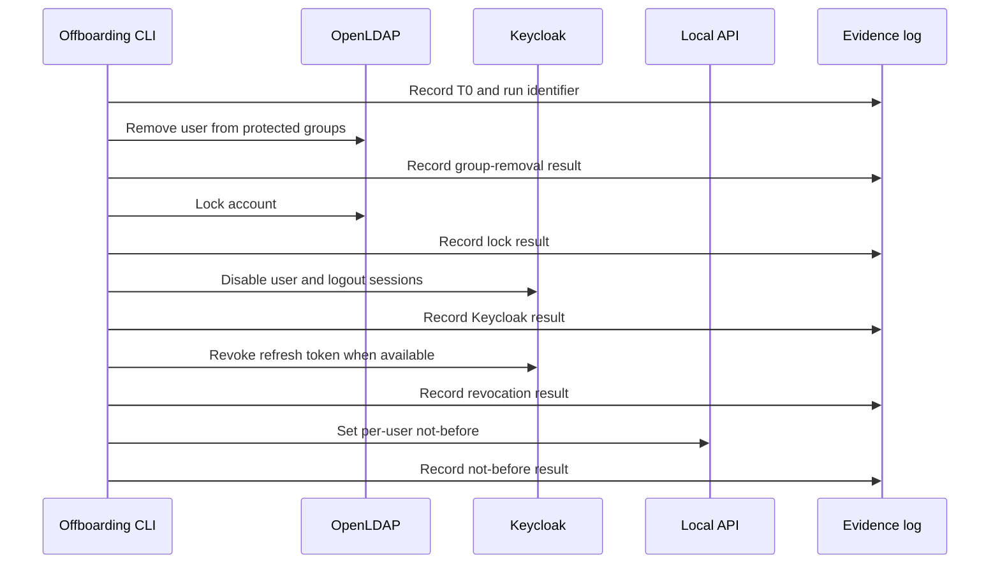

# System Architecture

## 1. Purpose

This laboratory demonstrates how identity, authorization, and token-validation choices affect the time required to remove API access after an employee leaves. It is intentionally production-shaped but locally reproducible and explainable.

The system must answer four questions with evidence:

1. Which routes can each profile access?
2. What survives after LDAP group membership is removed?
3. What survives after the account and Keycloak sessions are disabled?
4. What latency and identity-provider load does each validation mode introduce?

## 2. System context

## 3. Component responsibilities

| Component | Responsibility | Trust boundary |
|---|---|---|
| Traefik | TLS termination and public routing | Internet/browser to local service network |
| React web app | PKCE login, token inspection, documents UI, live matrix, and offboarding monitor | Untrusted browser; no client secret |
| Keycloak | OAuth/OIDC authorization server, sessions, token issuance, introspection, and revocation | Identity control plane |
| OpenLDAP | Authoritative users, group membership, and account-lock policy | Directory control plane |
| PostgreSQL | Keycloak-owned persistent state | Internal only; not shared with application services |
| TypeScript API | Token validation, route authorization, documents, metrics, and per-user not-before enforcement | Resource server |
| Scheduled job | Client Credentials token acquisition and periodic report execution | Confidential machine client |
| Offboarding service | Ordered LDAP and Keycloak changes plus timestamped evidence | Privileged internal operator surface |
| Test runner | Matrix, offboarding experiments, benchmarks, and chart generation | Lab-only automation |
| Prometheus/Grafana | Metrics collection and visualization | Read-only observability plane |

## 4. Deployment topology

All services run in Docker Compose on one development host. Containers communicate on private Compose networks; only Traefik and explicitly documented development ports are exposed.

| Public hostname | Purpose |
|---|---|
| `https://app.localhost` | Browser application |
| `https://auth.localhost` | OIDC endpoints used by browser clients |
| `https://api.localhost` | API routes for the three validation modes |
| `https://admin-auth.localhost` | Restricted Keycloak administration entrypoint |
| `https://grafana.localhost` | Local dashboards |

API prefixes are `/local`, `/introspection`, and `/cached`. They route to the same API image with a different validation-mode configuration, keeping authorization behavior identical while isolating the validation strategy.

The issuer visible in tokens is `https://auth.localhost/realms/company`. Containers may use a private backchannel URL for JWKS and introspection only when Keycloak is configured to preserve and validate the public issuer correctly.

## 5. Network and trust boundaries

Key rules:

- LDAP and PostgreSQL are never exposed through the public edge.
- The browser never receives a confidential-client secret.
- API introspection credentials exist only in the introspection API containers.
- The offboarding surface is internal, authenticated, and excluded from browser routing.
- Metrics must not include tokens, passwords, authorization headers, or client secrets.

## 6. Authentication flows

### 6.1 Browser login with Authorization Code and PKCE

Tokens remain in browser memory. Persistent browser storage is deliberately avoided. The report will note that a Backend-for-Frontend is a stronger production pattern for high-value browser applications.

### 6.2 Scheduled job with Client Credentials

## 7. Token-validation modes

### Local JWT mode

The API validates RS256 signature, `iss`, `aud`, `exp`, and `nbf` with a small documented clock tolerance. JWKS is cached and refreshed on a controlled schedule or unknown `kid`. After cryptographic validation, the API checks scope, LDAP-derived roles embedded in the token, service-account identity, and resource ownership.

This mode normally cannot observe a server-side logout until the token expires. The lab adds a per-user not-before value in authenticated persistent Redis: if `token.iat < user.notBefore`, the token is rejected. The mutation endpoint is internal-only and accepts monotonic updates authenticated with the generated offboarding secret.

### Introspection mode

The API sends the token to Keycloak's RFC 7662 endpoint using confidential API credentials. It rejects `active=false`, then independently rechecks issuer, audience, expiry, and authorization policy. No raw token or introspection credential is logged.

### Cached introspection mode

This mode uses the same checks but caches a positive introspection result for a bounded TTL. Cache entries never outlive the token's `exp`. The cache reduces Keycloak calls while intentionally creating a measurable revocation window.

## 8. Authorization evaluation

The complete route policy is in [authorization-model.md](authorization-model.md).

## 9. Offboarding flow

The workflow is fail-loud and stepwise. Each mutation records start time, finish time, target user, outcome, and a non-secret correlation ID. Retries must be idempotent: removing an absent membership, locking an already-locked account, logging out a sessionless user, and reapplying the same not-before value should converge safely.

## 10. Data and evidence model

The API begins with deterministic in-memory documents owned by `aya`, `ali`, and `marwa`. Persistence is not the research subject and should not obscure the authorization model.

Experiment outputs are append-only CSV rows keyed by run identifier:

- `matrix.csv`: profile, route, mode, expected status, obtained status, and latency.
- `offboarding.csv`: run, lifetime, mode, observed element, and delays from T0/T1.
- `bench.csv`: mode, request count, concurrency, throughput, p50/p95, and Keycloak calls.

Charts are generated only from committed CSV evidence. Generated raw tokens, credentials, and full authentication responses are never written to results.

## 11. Observability

Every API request receives a request ID and structured JSON log entry. Metrics use bounded labels—mode, route template, status class, and outcome—rather than usernames or token identifiers.

Required metrics include:

- request count and duration by validation mode;
- authentication duration p50/p95;
- Keycloak calls and calls per request;
- JWKS refreshes and introspection cache hit/miss counts;
- authorization result counts for 200, 401, and 403;
- offboarding step duration and observed revocation delay.

## 12. Security baseline

- Strong local secrets are generated into ignored `.env` files.
- Images and direct dependencies are pinned.
- Containers run as non-root where the upstream image permits it.
- Keycloak uses production-style `start` mode and a persistent database.
- Keycloak binds to LDAP with a read-only least-privilege account.
- LDAP uses persistent storage, `ppolicy`, and `memberOf` overlays.
- Refresh-token rotation is enabled with zero reuse.
- Admin and login events are enabled without recording secrets.
- CI scans secrets, dependencies, and images.
- Negative tests cover tampered signatures, wrong audience, expired tokens, missing scopes, wrong roles, and ownership violations.

## 13. Failure modes and recovery

| Failure | Expected behavior | Recovery evidence |
|---|---|---|
| Keycloak unavailable | Local mode continues with cached JWKS until an unknown key; introspection modes fail closed | Health state and failed-call metrics |
| LDAP unavailable | Existing Keycloak sessions may continue; new federated logins fail | Login event plus LDAP health evidence |
| Unknown signing key | Local API rate-limits JWKS refresh and fails closed if refresh cannot verify | JWKS refresh metric and 401 response |
| Introspection timeout | API fails closed with 401/503 policy finalized in ADR before implementation | Structured error without token contents |
| Offboarding partial failure | Workflow stops, records completed steps, and can be retried idempotently | Step receipts tied to run ID |
| API restart | Persistent not-before state remains in Redis | Restart proof reads the same cutoff and continues rejecting an older token |
| Redis unavailable | Local validation fails closed with 503; introspection modes remain independent | Dependency error metric and secret-free structured log |

## 14. Explicit non-goals

- A multi-tenant production IAM platform
- Internet-facing deployment or public certificate automation
- High-availability Keycloak, LDAP, or database clusters
- Using ROPC outside deterministic lab tests
- Treating unmeasured hypotheses as final conclusions
- Persisting SPA tokens in `localStorage`

## 15. Architecture acceptance

The architecture is considered implemented only when a clean clone can start without admin-console clicks, all three validation modes enforce the same authorization policy, the offboarding experiment produces reproducible CSV evidence, and the user can explain each trust boundary and measured tradeoff.
