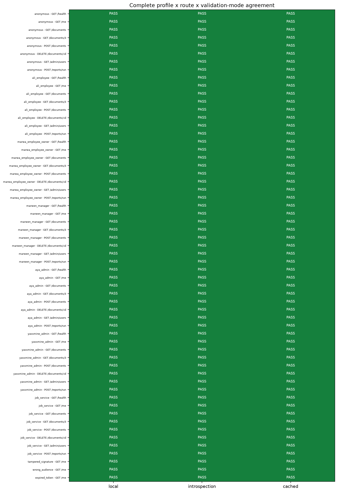
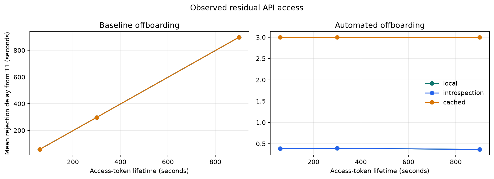
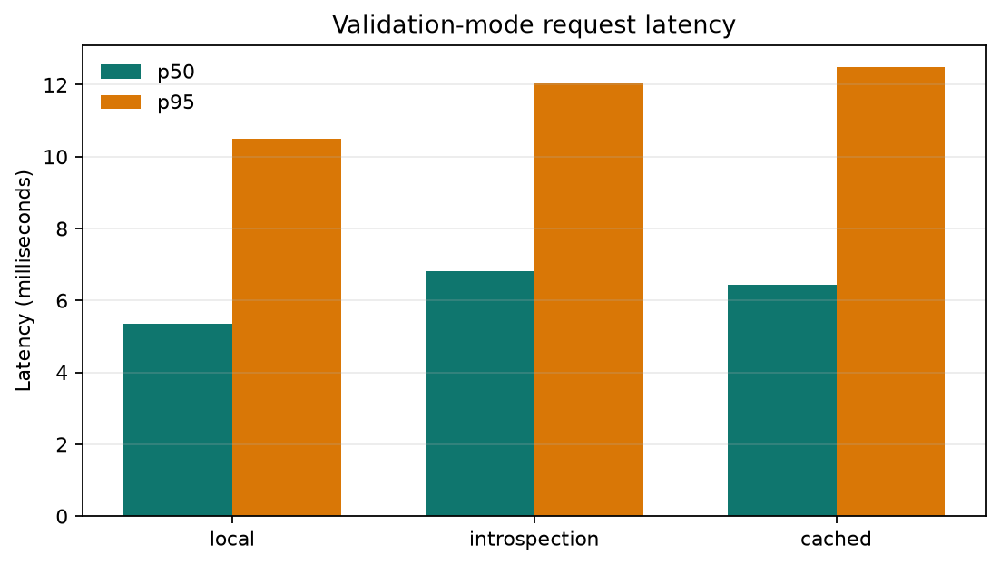

# Measuring Residual API Access During IAM Offboarding

## Abstract

Employee offboarding is not complete when a directory account is merely locked. Existing access
tokens, refresh sessions, cached validation decisions, and role claims can preserve API access for
different lengths of time. This project builds a reproducible IAM laboratory around OpenLDAP,
Keycloak, a TypeScript resource server, a browser security console, a scheduled machine workload,
and three token-validation strategies. It measures authentication and document authorization
separately before and after group removal and account lock.

The authorization matrix passed every case: **177<!-- metric:matrix_rows --> of
177<!-- metric:matrix_passes -->** rows, comprising
**75<!-- metric:matrix_status_200 --> HTTP 200**,
**15<!-- metric:matrix_status_201 --> HTTP 201**,
**9<!-- metric:matrix_status_204 --> HTTP 204**,
**30<!-- metric:matrix_status_401 --> HTTP 401**, and
**48<!-- metric:matrix_status_403 --> HTTP 403** outcomes
([matrix_rows, matrix_passes, matrix_status_200, matrix_status_201, matrix_status_204,
matrix_status_401, matrix_status_403](evidence-summary.json)).
The offboarding experiment produced **144<!-- metric:offboarding_rows --> observations across
18<!-- metric:offboarding_runs --> runs**
([offboarding_rows, offboarding_runs](evidence-summary.json)). Baseline access survived almost to
token expiry, while the automated protocol reduced local and uncached-introspection authentication
rejection to a **0.383<!-- metric:automated_local_auth_t1_mean -->-second mean** and
**0.428<!-- metric:automated_local_auth_t1_max -->-second measured maximum** after account lock
([automated_local_auth_t1_mean, automated_local_auth_t1_max](evidence-summary.json)). These results
show that token lifetime is an exposure ceiling only when rapid invalidation is unavailable; a
working offboarding control plane matters more than selecting one validation mode in isolation.

## 1. Context and objectives

The research question is: **after an employee is offboarded, how long can an already-issued token
still reach a protected API?** The lab has four objectives:

1. prove authentication and fine-grained authorization with exact REST success and refusal results;
2. compare local JWT validation, per-request RFC 7662 introspection, and bounded positive-cache
   introspection under the same authorization policy;
3. measure new-login, refresh-token, API-authentication, and document-authorization behavior during
   offboarding; and
4. turn measured exposure windows and operational cost into a risk-based recommendation.

The laboratory is educational rather than production infrastructure. Its value is that every
identity source, token decision, trust boundary, refusal path, and measurement is visible and can be
reproduced without manual administration-console configuration.

## 2. Architecture and trust boundaries

OpenLDAP is authoritative for people, passwords, and group membership. Keycloak reads LDAP through
a least-privilege, read-only federation identity and converts groups into realm roles. The browser
uses Authorization Code with PKCE; the scheduled job uses Client Credentials. Keycloak signs access
tokens, but the API owns resource authorization: scopes, roles, service identity, and document
ownership are evaluated in one shared policy after any of the three authentication strategies.

The public edge exposes only HTTPS routes through Traefik. PostgreSQL, Redis, Prometheus, LDAP, and
service-to-service management routes remain on private Docker networks. Redis stores monotonic
per-user not-before timestamps so local validation can reject an older, still correctly signed JWT.
Grafana is the presentation surface for metrics; Prometheus has no host port.

The principal trust boundaries are:

- browser to Traefik: untrusted input enters over HTTPS;
- Traefik to application services: only declared public routes cross the edge;
- API to Keycloak: introspection modes depend on a confidential client and live IdP availability;
- Keycloak to LDAP: federation can read identities but cannot modify the directory;
- API to Redis: only modes that enforce local not-before receive the store credential; and
- monitoring plane: metrics use bounded, non-identity labels and never include tokens or secrets.

The detailed component and sequence diagrams are in
[docs/architecture.md](../docs/architecture.md), while the complete route policy is in
[docs/authorization-model.md](../docs/authorization-model.md).

## 3. Authorization and validation design

A request is authenticated only after exact issuer and audience checks, signature validation or a
valid introspection response, expiry checks, and extraction of a stable subject. Authentication
failures return 401. A valid principal that lacks a required scope, role, service identity, or
ownership relationship receives 403. This separation matters: offboarding can remove document
authorization before an old token becomes cryptographically invalid.

The three deployments share all routes and policy code:

| Mode | Authentication decision | Main benefit | Main cost |
|---|---|---|---|
| Local JWT | Verify signature and claims locally, then enforce per-user not-before | No Keycloak call per normal request; survives IdP outage for known keys | Without not-before automation, an old token lives until expiry |
| Introspection | Ask Keycloak for every request | Immediate central state and LDAP-derived role re-evaluation | One IdP call per request and a runtime dependency on Keycloak |
| Cached introspection | Cache only positive introspection results for a bounded interval | Reduces IdP load while bounding stale decisions | Revocation visibility is delayed by the remaining cache interval |

## 4. Method

The external matrix applies the same profile-by-route cases to every mode. It includes anonymous,
owner, cross-owner, manager, administrator, job, expired-token, wrong-audience, and tampered-token
profiles. Expected and obtained HTTP statuses, latency, and pass/fail outcome are written to
`results/matrix.csv`.

For offboarding, each run obtains Marwa's active access and refresh tokens, then records:

- **T0:** removal from the LDAP `employees` group;
- **T1:** LDAP account lock, followed by optional automated logout, refresh-token revocation, and
  per-user not-before update;
- the first observed refusal of new login, refresh, authenticated API access, and document access.

The protocol covers 60-, 300-, and 900-second access-token lifetimes, baseline and automated
offboarding, and three repetitions. Polling occurs once per second; exact sub-second results come
from the timestamped mutation and first probe rather than from a synthetic expectation. Censored
observations remain in the CSV.

The benchmark sends 1,000 authenticated requests at concurrency 10 to each mode in the same local
environment. It records successful requests, throughput, p50/p95 latency, and measured identity-
provider calls. These are comparative lab measurements, not production capacity claims.

## 5. Results

### 5.1 Authorization matrix

All **177<!-- metric:matrix_rows -->/177<!-- metric:matrix_passes --> cases passed**
([matrix_rows, matrix_passes](evidence-summary.json)). The complete policy product covered seven
profiles and eight public route operations in all three validation modes; nine additional cases
proved rejection of tampered, wrong-audience, and expired tokens. The observed outcomes were
**75<!-- metric:matrix_status_200 --> HTTP 200**,
**15<!-- metric:matrix_status_201 --> HTTP 201**,
**9<!-- metric:matrix_status_204 --> HTTP 204**,
**30<!-- metric:matrix_status_401 --> HTTP 401**, and
**48<!-- metric:matrix_status_403 --> HTTP 403**
([matrix_status_200, matrix_status_201, matrix_status_204, matrix_status_401,
matrix_status_403](evidence-summary.json)). The 201 and 204 results preserve correct REST semantics
for document creation and deletion rather than flattening every successful operation to 200.



### 5.2 Baseline offboarding

Without automated token invalidation, local-token authentication remained available for a mean of
**58.000<!-- metric:baseline_local_auth_t1_mean_60s --> seconds**,
**297.667<!-- metric:baseline_local_auth_t1_mean_300s --> seconds**, and
**898.000<!-- metric:baseline_local_auth_t1_mean_900s --> seconds** after T1 for the three
configured lifetimes
([baseline_local_auth_t1_mean_60s, baseline_local_auth_t1_mean_300s, baseline_local_auth_t1_mean_900s](evidence-summary.json)).
The two introspection modes showed the same authentication lifetime in this protocol because locking
the LDAP account stopped new login but did not itself invalidate the already-issued token.

The role change was visible sooner than token invalidation. Uncached introspection removed Marwa's
document authorization **0.141<!-- metric:baseline_introspection_document_t0_mean --> seconds after
T0 on average**, while cached introspection reflected it after
**5.000<!-- metric:baseline_cached_document_t0_mean --> seconds**
([baseline_introspection_document_t0_mean, baseline_cached_document_t0_mean](evidence-summary.json)).
The token could still be active while the protected document call correctly returned 403.

New password login was rejected **0.146<!-- metric:baseline_new_login_t1_mean --> seconds after T1
on average** ([baseline_new_login_t1_mean](evidence-summary.json)), but all
**9<!-- metric:baseline_refresh_censored --> baseline refresh chains were censored** at the
observation deadline ([baseline_refresh_censored](evidence-summary.json)). Account lock is therefore
not a substitute for refresh-session revocation.

### 5.3 Automated offboarding

The automated protocol combines LDAP changes with Keycloak logout/revocation and the local API's
per-user not-before cutoff. New-login rejection averaged
**0.383<!-- metric:automated_new_login_t1_mean --> seconds after T1**, and refresh rejection also
averaged **0.383<!-- metric:automated_refresh_t1_mean --> seconds**
([automated_new_login_t1_mean, automated_refresh_t1_mean](evidence-summary.json)). Local validation
rejected the old token after a **0.383<!-- metric:automated_local_auth_t1_mean -->-second mean**;
uncached introspection also averaged
**0.383<!-- metric:automated_introspection_auth_t1_mean --> seconds**
([automated_local_auth_t1_mean, automated_introspection_auth_t1_mean](evidence-summary.json)).

Cached introspection rejected authentication
**3.000<!-- metric:automated_cached_auth_t1_mean --> seconds after T1**, which was
**5.000<!-- metric:automated_cached_auth_t0_mean --> seconds after T0** because the positive cache
entry was created before the account lock
([automated_cached_auth_t1_mean, automated_cached_auth_t0_mean](evidence-summary.json)). This is the
expected security/performance trade-off of a bounded positive cache, demonstrated by measurement.

The dataset contains **135<!-- metric:offboarding_observed --> observed** and
**9<!-- metric:offboarding_censored --> censored rows**
([offboarding_observed, offboarding_censored](evidence-summary.json)); nothing was silently dropped.



### 5.4 Performance and identity-provider dependence

| Mode | Throughput | p50 | p95 | Keycloak calls/request | Evidence IDs |
|---|---:|---:|---:|---:|---|
| Local | 1710.136<!-- metric:bench_local_throughput_rps --> req/s | 5.344<!-- metric:bench_local_latency_p50_ms --> ms | 10.501<!-- metric:bench_local_latency_p95_ms --> ms | 0.000<!-- metric:bench_local_keycloak_calls_per_request --> | `bench_local_throughput_rps`, `bench_local_latency_p50_ms`, `bench_local_latency_p95_ms`, `bench_local_keycloak_calls_per_request` |
| Introspection | 1230.949<!-- metric:bench_introspection_throughput_rps --> req/s | 6.815<!-- metric:bench_introspection_latency_p50_ms --> ms | 12.070<!-- metric:bench_introspection_latency_p95_ms --> ms | 1.000<!-- metric:bench_introspection_keycloak_calls_per_request --> | `bench_introspection_throughput_rps`, `bench_introspection_latency_p50_ms`, `bench_introspection_latency_p95_ms`, `bench_introspection_keycloak_calls_per_request` |
| Cached | 1437.010<!-- metric:bench_cached_throughput_rps --> req/s | 6.424<!-- metric:bench_cached_latency_p50_ms --> ms | 12.479<!-- metric:bench_cached_latency_p95_ms --> ms | 0.008<!-- metric:bench_cached_keycloak_calls_per_request --> | `bench_cached_throughput_rps`, `bench_cached_latency_p50_ms`, `bench_cached_latency_p95_ms`, `bench_cached_keycloak_calls_per_request` |

Every value in this table maps to the corresponding full metric ID in
[evidence-summary.json](evidence-summary.json), derived from `results/bench.csv`. Local validation
was the fastest and removed per-request Keycloak dependence. Uncached introspection paid for current
central state with exactly one call per request. The bounded cache retained most of the central
control while reducing measured calls to
0.008<!-- metric:bench_cached_keycloak_calls_per_request --> per request.



## 6. Risk-based recommendation

The recommendation treats residual access as a control budget, not only a token setting. An
expiry-only local strategy is bounded approximately by access-token lifetime plus the configured
clock tolerance; the measured post-T1 baseline was just under the nominal lifetime because T1
occurred after token issuance. Automated not-before or uncached introspection reduced the observed
window to sub-second mutation/probe time, while cached introspection was bounded by its positive
cache interval.

| Risk | Access-token lifetime | Validation mode | Refresh/session controls | Measured justification |
|---|---|---|---|---|
| High | 60 seconds | Uncached introspection, or local JWT only with mandatory per-user not-before | Rotation with zero reuse; revoke refresh token and logout sessions during offboarding | Automated local/uncached rejection mean 0.383<!-- metric:automated_local_auth_t1_mean --> s; measured maximum 0.428<!-- metric:automated_local_auth_t1_max --> s. If automation fails, the 60 s baseline remained active 58.000<!-- metric:baseline_local_auth_t1_mean_60s --> s after T1. |
| Medium | 300 seconds | Cached introspection with a 5-second positive cache | Rotation with zero reuse; revoke and logout during offboarding | Cached rejection was 5.000<!-- metric:automated_cached_auth_t0_mean --> s from T0 / 3.000<!-- metric:automated_cached_auth_t1_mean --> s from T1, with 0.008<!-- metric:bench_cached_keycloak_calls_per_request --> Keycloak calls/request. |
| Low | 900 seconds | Local JWT with automated per-user not-before | Rotation with zero reuse; revoke and logout during offboarding; monitor automation health | Automated local rejection mean 0.383<!-- metric:automated_local_auth_t1_mean --> s with no normal Keycloak calls/request; without automation the measured baseline remained active 898.000<!-- metric:baseline_local_auth_t1_mean_900s --> s after T1. |

The numeric cells cite
[automated_local_auth_t1_mean, automated_local_auth_t1_max,
baseline_local_auth_t1_mean_60s, automated_cached_auth_t0_mean,
automated_cached_auth_t1_mean, bench_cached_keycloak_calls_per_request,
baseline_local_auth_t1_mean_900s](evidence-summary.json). The recommendation is conditional: if the
offboarding workflow or not-before store cannot be monitored and trusted, the organization must
choose a short expiry or live introspection rather than assuming automation succeeded.

## 7. Limitations

- This is a single-node local Docker laboratory. It does not measure multi-region propagation,
  network partitions, external identity providers, or production load.
- ROPC is used only by deterministic test tooling. The browser uses Authorization Code with PKCE;
  a production SPA should normally prefer a backend-for-frontend so browser JavaScript does not own
  long-lived credentials.
- The three-repetition experiment describes this environment and implementation. It supports a
  course-level comparison but not broad statistical generalization.
- Polling is once per second, so exact revocation time lies between the last successful and first
  refused probe. Sub-second values represent observed orchestration/probe timing, not millisecond
  precision of every internal propagation step.
- Cached introspection results depend on when a positive entry was created relative to T0 and T1.
- The benchmark compares modes under identical local conditions; it is not a sizing result or
  service-level objective.

## 8. Conclusion

The laboratory demonstrates that authentication, authorization, account state, and token state are
different controls. Removing a group can revoke resource authorization before authentication ends;
locking an account blocks new login but can leave refresh and access tokens usable; and a signed JWT
can be rejected quickly when a separate, durable not-before control exists.

The strongest practical conclusion is to combine controls: short lifetimes appropriate to risk,
refresh rotation, explicit logout/revocation, rapid group and account changes, per-user invalidation
for local JWTs, bounded caches, and observable automation. Validation mode changes the performance
and availability trade-off, but a complete offboarding workflow determines the real residual-access
window.

## Appendix A. Reproduction

Prerequisites and trusted-certificate setup are documented in
[docs/development.md](../docs/development.md). From a clean clone:

```bash
cp .env.example .env
make secrets
make certs
make up
make test
make export
```

`make test` proves API, console, job, matrix, metrics, and dashboard behavior. `make export` validates
the committed experiment protocol, regenerates figures, and refreshes the report evidence ledger.
The destructive `make reset CONFIRM=reset` command is never part of normal reproduction or a live
presentation.

To run a single retry-safe offboarding demonstration for Marwa:

```bash
make offboard USER=marwa
make restore USER=marwa
make matrix-test
```

The offboarding command intentionally leaves Marwa locked, disabled, and without employee
membership so the refusal can be observed. The separate restore command returns her to the declared
employee baseline; the matrix then proves recovery. Both mutation paths refuse any other username.

Use the timed [presentation demo script](../docs/demo-script.md) for the live demonstration. The canonical
CSV-to-report mapping is [evidence-summary.json](evidence-summary.json); it records the source file,
row selection, calculation, value, and unit for every experimental metric used above.
